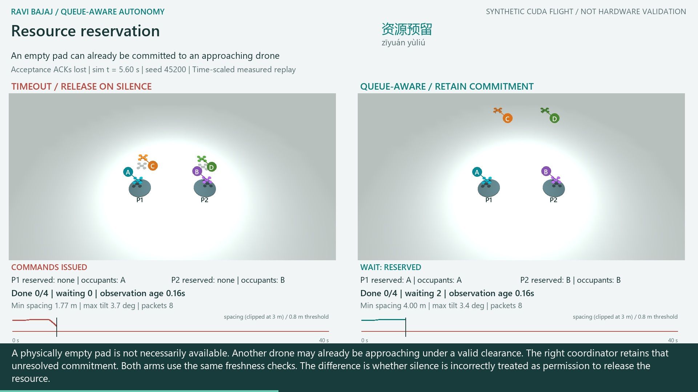
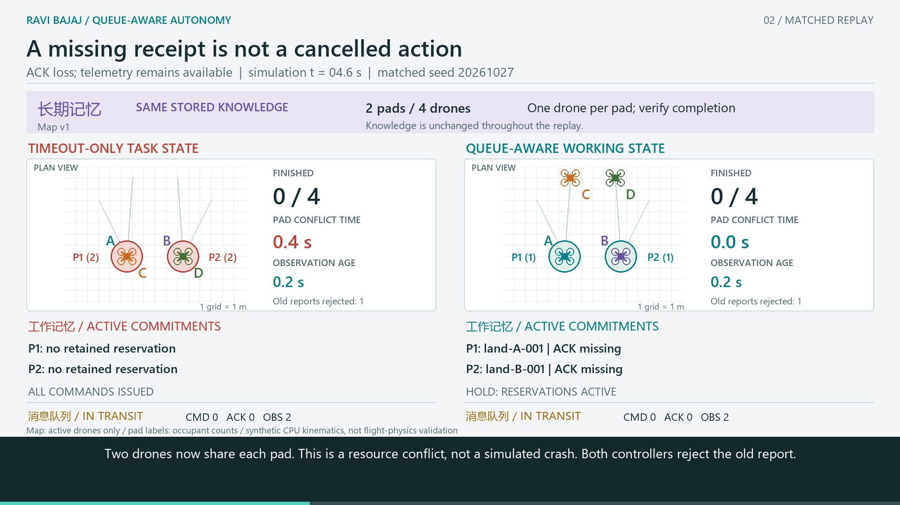
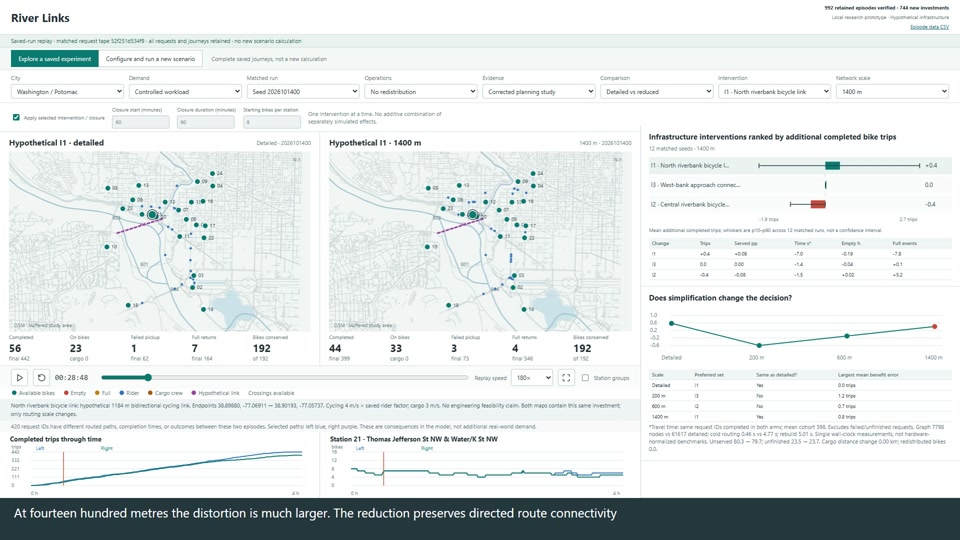
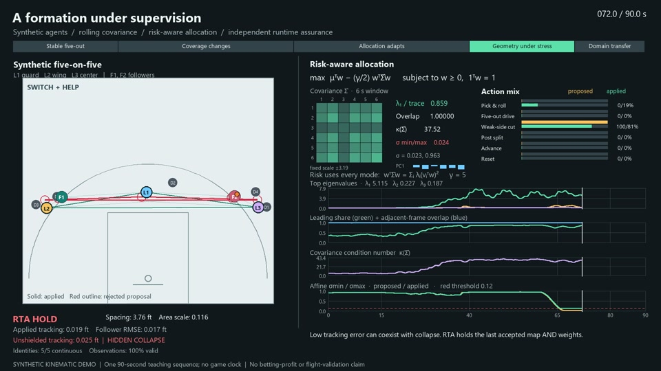
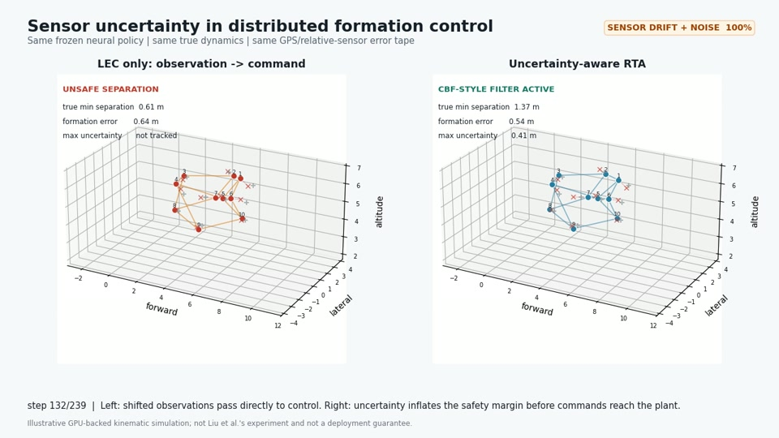
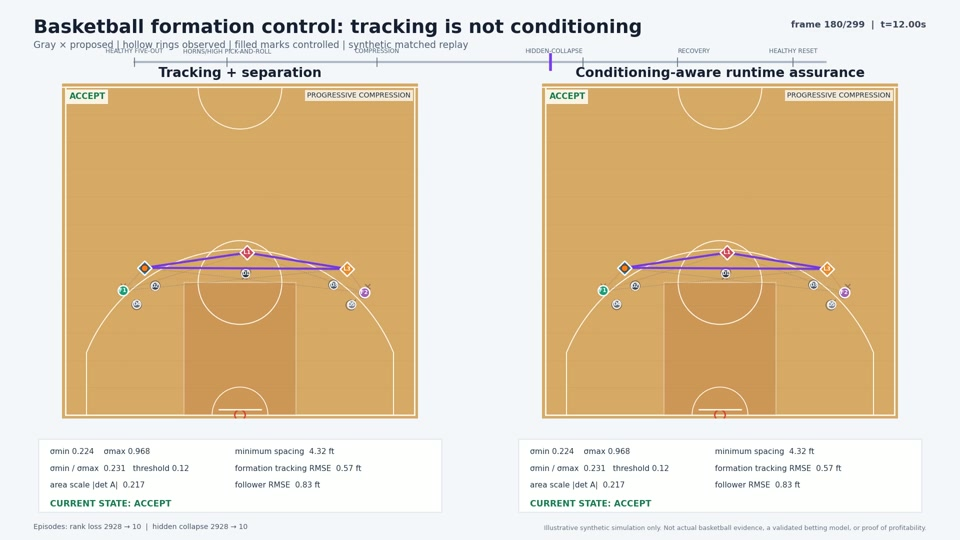

# Delay-Aware Runtime Assurance Lab

## New: Queue-Aware Drone Fleets with GPU Flight Physics

[](https://github.com/rbajaj5/delay-aware-runtime-assurance-lab/releases/download/gpu-fleet-active-state-2026-10-27/queue_aware_gpu_fleet.mp4)

**[Watch the narrated 3:42 MP4](https://github.com/rbajaj5/delay-aware-runtime-assurance-lab/releases/download/gpu-fleet-active-state-2026-10-27/queue_aware_gpu_fleet.mp4)**
| **[Research question, methods, results and reproduction](experiments/20261027_gpu_fleet_active_state/README.md)**

**Measured final rendering/encoding: 176.89 s; audio/subtitle mux: 2.30 s.**
These exclude simulation, speech synthesis, setup and validation.
[Hardware and timing details](experiments/20261027_gpu_fleet_active_state/delivery/timing.json).

This illustrates **Ravi Bajaj's queue-aware assured-autonomy work** through four
quadrotors sharing two landing resources. Missing acceptance receipts do not mean
that the original commands stopped executing. Retaining the outstanding
commitment avoids double-booking in the tested cases; without fresh completion
evidence, that same rule leaves other agents waiting.

**48 matched CUDA-integrated episodes:** with acceptance receipts lost, pad
conflicts occurred in **8/8 timeout episodes versus 0/8 queue-aware episodes**.
With fresh telemetry the queue-aware fleet completes all four tasks; during a
telemetry outage it completes only two. Both arms complete four under timely
messages. The film shows the same fixed seed, synchronized flight states and task
records, English narration, Mandarin terms and captions.

Mass, inertia, gravity, bounded rotor thrust and contacts are integrated by
MuJoCo Warp on an RTX 5070 Ti Laptop GPU. Scheduling and local feedback run on
CPU. Rendering and encoding are distinct from GPU physics. This is a deliberately
constructed **exploratory simulation**, not a reliability estimate, formal safety
certificate, learned-controller result or hardware validation. The
[registered course study](course_study/README.md) remains separate.

## Earlier Video: Long-term Memory vs Working Memory

[](https://github.com/rbajaj5/delay-aware-runtime-assurance-lab/raw/refs/heads/main/experiments/20261026_memory_layers/delivery/memory_layers_drone_fleet.mp4)

**[Watch/download the 2:08 MP4](https://github.com/rbajaj5/delay-aware-runtime-assurance-lab/raw/refs/heads/main/experiments/20261026_memory_layers/delivery/memory_layers_drone_fleet.mp4)**
with English narration, Chinese labels, and captions. **长期记忆** stores reusable
knowledge; **工作记忆** maintains the active task; **消息队列** carries updates.
Both drone coordinators know the same map and procedures. A missing receipt
exposes the difference between timing out an unresolved reservation and retaining
it until completion is verified. A telemetry-outage counterexample shows the
resulting cost in unfinished tasks.

This is a new **synthetic CPU kinematic teaching model**, not GPU flight physics
or a model of human cognition. The synchronized replay and 192 bounded timing
runs are exploratory and do not extend the registered course-study claims.
[Methods, code, states, and validation](experiments/20261026_memory_layers/README.md).

## Working Memory / 工作记忆

The [working-memory example](experiments/20261026_working_memory/README.md)
adds an English-narrated explainer with Chinese definitions, newly matched
multi-agent queue replays, and executable basketball, gardening, and laundry
coordination examples. It also exercises the existing laundry supervisor and
clearly separates the new discrete models from a retained humanoid physics clip.
[Download the 1080p MP4](https://github.com/rbajaj5/delay-aware-runtime-assurance-lab/raw/refs/heads/main/experiments/20261026_working_memory/delivery/Working_Memory_Assured_Autonomy.mp4)
and [sources](experiments/20261026_working_memory/delivery/Sources_and_Methods.txt).
Open the downloaded MP4 in your video player. GitHub's file page does not preview
this video; the download link above goes directly to the file (2:40, 7.18 MiB).
The video is included with this example; it is separate from the release assets below.

## Videos and MP4 Demonstrations

**Start with a movie.** Click a preview or an **MP4** link below to open/download the original video. [All eight MP4s](https://github.com/rbajaj5/delay-aware-runtime-assurance-lab/releases/tag/videos-2026-10-24) are available without cloning the repository.

These are recorded simulations and teaching demonstrations, not field trials. The final course study and its registered evidence remain [separately identified](course_study/README.md); the movies do not extend those claims.

| Infrastructure planning | Covariance and runtime assurance |
| --- | --- |
| [](https://github.com/rbajaj5/delay-aware-runtime-assurance-lab/releases/download/videos-2026-10-24/river_links_planning_narrated.mp4) | [](https://github.com/rbajaj5/delay-aware-runtime-assurance-lab/releases/download/videos-2026-10-24/portfolio_rta_synchronized.mp4) |
| **[MP4: planning laboratory](https://github.com/rbajaj5/delay-aware-runtime-assurance-lab/releases/download/videos-2026-10-24/river_links_planning_narrated.mp4)** · 3:00 · narrated + captions. Fixed crossing interventions, service outcomes, and model-resolution sensitivity. [Methods](experiments/20261014_bikeshare_multiscale/README_PLANNING.md). | **[MP4: synchronized allocation and RTA](https://github.com/rbajaj5/delay-aware-runtime-assurance-lab/releases/download/videos-2026-10-24/portfolio_rta_synchronized.mp4)** · 1:30 · silent, on-screen telemetry. Synthetic actions and covariance evolve together; an independent geometry gate can reject the proposal. [Methods](artifacts/20261013/portfolio_rta/README.md). |
| **3D formation under sensor uncertainty** | **Basketball affine conditioning** |
| [](https://github.com/rbajaj5/delay-aware-runtime-assurance-lab/releases/download/videos-2026-10-24/sensor_uncertainty_rta_comparison_narrated.mp4) | [](https://github.com/rbajaj5/delay-aware-runtime-assurance-lab/releases/download/videos-2026-10-24/basketball_affine_conditioning_v2.mp4) |
| **[MP4: sensor uncertainty](https://github.com/rbajaj5/delay-aware-runtime-assurance-lab/releases/download/videos-2026-10-24/sensor_uncertainty_rta_comparison_narrated.mp4)** · 0:22 · narrated + on-screen captions. Learned control versus uncertainty-aware RTA in a kinematic simulation. [Report](artifacts/20260808/sensor_uncertainty_3d/sensor_uncertainty_rta_report.md). | **[MP4: conditioning comparison](https://github.com/rbajaj5/delay-aware-runtime-assurance-lab/releases/download/videos-2026-10-24/basketball_affine_conditioning_v2.mp4)** · 0:20 · silent. Low tracking residual need not imply well-conditioned geometry. Synthetic players, not betting evidence. [Methods](artifacts/20260813/basketball_affine_conditioning_v2/README.md). |

### More Videos

| Demonstration | MP4 | Sound | Context |
| --- | --- | --- | --- |
| Fleet coordination on changing networks | [3:00 MP4](https://github.com/rbajaj5/delay-aware-runtime-assurance-lab/releases/download/videos-2026-10-24/fleet_changing_networks.mp4) | Narrated + captions | [Schematic bridge-fleet prototype](experiments/20261014_bridge_fleet/README.md) |
| 3D affine-conditioning comparison | [0:22 MP4](https://github.com/rbajaj5/delay-aware-runtime-assurance-lab/releases/download/videos-2026-10-24/affine_conditioning_comparison.mp4) | Silent | [Illustrative geometry experiment](artifacts/20260811/affine_conditioning_gpu/affine_conditioning_report.md) |
| 3D landing coordination | [0:12 MP4](https://github.com/rbajaj5/delay-aware-runtime-assurance-lab/releases/download/videos-2026-10-24/helicopter_3d_delay_comparison.mp4) | Silent | [Exploratory delayed-clearance replay](artifacts/20260802/helicopter_3d/helicopter_3d_report.md) |
| Delayed-observation policy comparison | [0:14 MP4](https://github.com/rbajaj5/delay-aware-runtime-assurance-lab/releases/download/videos-2026-10-24/hex_policy_comparison_delay3_seed0.mp4) | Silent | [Hex-like coordination, delay 3, seed 0](artifacts/20260730/hex_policy_comparison_delay3_seed0_report.md) |

The MP4s are release assets; small preview images live in Git. Playback versus download depends on the browser. [Video metadata and SHA-256 hashes](docs/media/video_catalog.json) identify the exact retained files. All eight passed a full media-decode check; this is not a new replication of their scientific results. [Media scope and reproduction](docs/media/README.md).

## Public Research Collection

The October 24, 2026 source release adds the [final course study](course_study/README.md), later formation/risk-allocation demonstrations, and the [multiscale infrastructure-planning laboratory](experiments/20261014_bikeshare_multiscale/README_PLANNING.md). [Release scope and exclusions](docs/PUBLIC_RELEASE_20261024.md) distinguish registered evidence from exploratory extensions and identify large files retained locally. The current working tree includes source and compact evidence, not every raw trace or map cache.

The class literature-retrieval system is a separate repository: [Assured Autonomy Agentic RAG](https://github.com/rbajaj5/assured-autonomy-rag). The RAG is not a substitute for simulation or formal assurance evidence.

## Original Exploratory Sandbox

Small, reproducible simulations for studying how delayed messages, finite queues, and queue-aware processing affect multi-agent coordination.

The original repository was an exploratory companion to the delay-aware runtime-assurance work. Its sandbox experiments remain exploratory, not registered evidence or a safety case. The separately labeled `course_study/` directory now carries the final manuscript and selected registered evidence; those labels do not transfer to other folders.

## What is here

- `analysis/`: standalone Python simulations and read-only diagnostics.
- `paper/queue-aware-coordination-draft.md`: the current self-contained manuscript draft for the queue benchmark.
- `paper/queue-aware-coordination-draft.docx`: formatted DOCX version of the manuscript draft.
- `paper/build_queue_paper_docx.py`: reproducible DOCX builder.
- `artifacts/20260730/`: CSV outputs, plots, replay artifacts, reports, and SHA-256 manifests from the runs.
- `REPO_MANIFEST.sha256`: hash manifest for the repository's tracked files, generated after assembly.

The most recent experiments are:

- `run_semantic_queue_pollution_simulation.py`: useful coordination traffic competing with low-value background traffic under finite service capacity.
- `run_queue_semantic_decision_simulation.py`: downstream decision staleness caused by acting on delayed neighbor state.
- `run_fair_queue_multiagent_simulation.py`: FIFO, strict priority, and bounded-aging queue disciplines, measuring the trade-off between stale decisions and background-message starvation.
- `run_crossplay_delay_protocol_simulation.py`: an OvercookedV2-inspired asymmetric-information signaling game with cross-play convention mismatch and delayed, sequence-aware feedback.
- `run_delay_concentration_diagnostic.py`: compares global stale-event mass with spatial and temporal concentration under equal-mean spread versus clustered delay schedules.
- `run_jl_projection_safety_diagnostic.py`: tests whether random-projection geometry preservation also preserves a coordinatewise safety predicate; in this toy setting it does not.
- `run_helicopter_3d_landing_simulation.py`: renders an exploratory 3D helicopter landing-coordination replay under delayed clearances, comparing delay-blind and queue-aware freshness handling.
- `run_3d_formation_delay_monitor_simulation.py`: runs a CUDA-capable 3D formation-monitor demonstration with delayed messages, a bounded perturbation, and a separation fallback.
- `analyze_helicopter_network.py`: derives temporal conflict-graph, component, motif, and spectral diagnostics from the retained helicopter trace without rerunning the simulation.
- `derive_prime_graph_signature.py`: derives an optional prime-labeled arithmetic fingerprint from the retained conflict graph without rerunning the simulation.

The bounded-aging run is the current multi-agent extension. At delay 3 and background load 4 messages per agent per round, the exploratory mean stale-decision rates were approximately 0.496 for FIFO, 0.217 for strict priority, and 0.362 for priority with aging. The aging policy served roughly 2,125 background messages per game, while strict priority served roughly 46. These values are mechanism diagnostics, not registered claims.

The literature notes in `docs/` include scoped connections to zero-shot coordination, oracle-consistency evaluation, and physics-informed kernel surrogates. They are conceptual guides, not additional evidence for the simulation results.
- `run_delay_random_matrix_loop_diagnostic.py`: a finite random-matrix diagnostic for delayed receipt-age structure and loop residuals.
- `run_delay_ensemble_transfer.py`: transfer of the same queue policies across ring, random-regular, and two-block topologies.
- `run_delay_branch_sector_diagnostic.py`: branch/sector separation diagnostics for a complex phase surrogate.
- `run_hex_multiagent_delay_cascade.py`: delayed coordination in a small Hex-like multi-agent board.

## Reproduce the newest runs

From the repository root:

```powershell
python analysis/run_semantic_queue_pollution_simulation.py
python analysis/run_queue_semantic_decision_simulation.py
```

The scripts write outputs to the sibling workspace layout used during development. To run them entirely inside a clone, set the output location in the scripts to a repository-local artifact directory before execution.

The simulations use Python, NumPy, pandas, and Matplotlib where needed. No simulator harness, manuscript, or registered result is modified by these scripts. In a clone, outputs are written under `analysis/out/`; the checked-in run products are retained under `artifacts/20260730/`.

## Interpretation boundary

The queue policies are deliberately simple abstractions. `priority_deduplicating` is not automatically safe: it can starve background work, requires an explicit message taxonomy, and needs boundedness, authentication, auditability, and failure-handling rules before deployment. The random-matrix and branch diagnostics are finite empirical probes; they do not establish Wigner, Sine-beta, Airy-beta, or universality claims.

Every result should be read together with its report and source manifest. Numbers in this repository are exploratory unless a separate artifact explicitly says otherwise. The original `REPO_MANIFEST.sha256` is a historical assembly manifest, not a hash list for the later additions; see `docs/PUBLIC_RELEASE_MANIFEST.json` for this source release.

## License

Code is released under the MIT License. Generated artifacts are provided for reproducibility and inspection.
