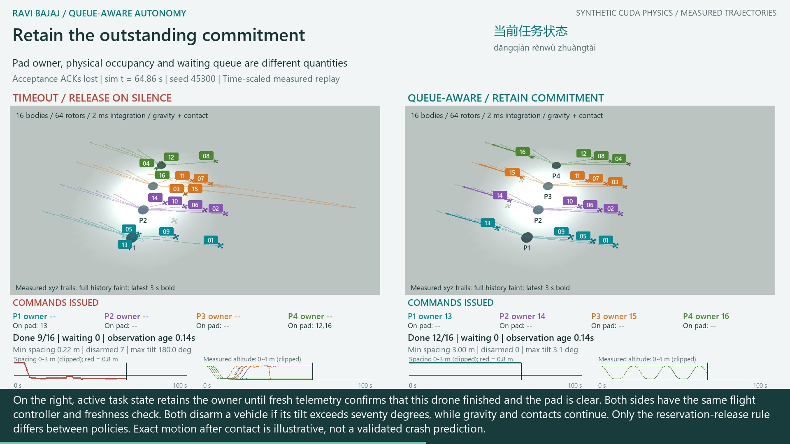

# Sixteen Drones: GPU Flight Physics and Queue-Aware Coordination

An expanded illustration of **Ravi Bajaj's queue-aware assured-autonomy work**:
16 physical quadrotors, four shared landing pads, four successive task waves.
The earlier [four-drone experiment](../20261027_gpu_fleet_active_state/README.md)
remains intact. This is a new experiment, not duplicated animation or pooled data.

[](https://github.com/rbajaj5/delay-aware-runtime-assurance-lab/releases/download/gpu-fleet-trajectories-2026-10-27/sixteen_drone_gpu_trajectories.mp4)

**[Narrated 1080p MP4](https://github.com/rbajaj5/delay-aware-runtime-assurance-lab/releases/download/gpu-fleet-trajectories-2026-10-27/sixteen_drone_gpu_trajectories.mp4)**
| [Script](lesson.json) | [Captions](delivery/captions.srt)
| [Episode results](evidence_v2/summary.json) | [Aggregates](evidence_v2/aggregates.json)

**Measured rendering + encoding: 418.13 s (6:58); audio/subtitle mux: 3.15 s.**
One observed run, 5,033 frames, 1920x1080 at 25 fps, duration 201.32 s. These
timings exclude GPU simulation, speech synthesis, renderer setup, audio assembly
and validation. Core Ultra 9 275HX / 32 GB RAM; RTX 5070 Ti Laptop GPU / 12 GB
for physics; Intel Graphics OpenGL for replay; CPU libx264 for encoding.
[Exact timing record](delivery/timing.json).

## Measured Results

Each row contains eight episodes of 100 s. Completion counts are out of 16
missions per episode. These are constructed cases, not estimated field rates.

| Messages | Policy | Pad-conflict episodes | Separation-violation episodes | Mean completed (range) |
|---|---|---:|---:|---:|
| Timely | Timeout | 0/8 | 0/8 | 16 (16-16) |
| Timely | Queue-aware | 0/8 | 0/8 | 16 (16-16) |
| Acceptance ACKs lost | Timeout | 8/8 | 8/8 | 10 (6-14) |
| Acceptance ACKs lost | Queue-aware | 0/8 | 0/8 | 16 (16-16) |
| ACK loss + telemetry outage | Timeout | 8/8 | 8/8 | 0 (0-0) |
| ACK loss + telemetry outage | Queue-aware | 0/8 | 0/8 | 4 (4-4) |

The lost-ACK timeout completion counts, in seed order, are
**9, 12, 10, 8, 12, 14, 9, 6**. The movie's fixed first seed therefore shows 9,
not the eight-seed mean of 10. With telemetry unavailable, the queue-aware
policy leaves **12 drones waiting** in every seed. Zero observed conflicts in
eight constructed cases is not a guarantee of safety.

The completed main batch took **165.72 s** for GPU stepping, CPU control and
recording, plus **12.81 s** for setup/kernel loading. Video timing is separate.

## What Is Actually on the GPU?

**MuJoCo Warp integrates the flight/contact dynamics on an NVIDIA RTX 5070 Ti
Laptop GPU.** Each world has 96 velocity degrees of freedom and 64 bounded rotor
actuators. The model includes 1.2 kg bodies, diagonal inertias
(0.025, 0.025, 0.045) kg m^2, gravity, thrust/torque, and hull/landing-foot contacts.
Rotor force is limited to 0-6 N each. Physics advances in 2 ms steps; deterministic
local feedback and task scheduling update every 20 ms on CPU.

The drones track smooth position references using bounded rotor commands.
Their positions are **not assigned to those references** during the simulation.
The renderer separately loads recorded qpos/qvel, computes rendering transforms
and draws them with OpenGL. CPU libx264 encodes the film. GPU physics, GPU
rendering and GPU encoding are different claims; only the first is made here.
CUDA is required; the experiment fails rather than silently using CPU physics.

In the film, faint lines are full measured xyz histories and bold lines show
the most recent three simulated seconds. They are projected from 3D coordinates,
not drawn from the target/reference curves. Altitude histories evolve at the
same simulation timestamp. Plot ranges are explicitly clipped for legibility.
IDs 01-16 persist; colors identify the four preassigned pad lanes.

## The Matched Comparison

- Eight seeds (45300-45307), three communication profiles, two policies:
  **48 physically isolated worlds**, 16 drones in each, 100 s per episode.
  This is not one 768-drone swarm. Matched arms and profiles share random inputs;
  they are not 48 independent statistical replicates. Each profile has eight
  matched policy pairs.
- Both arms share initial states, local control, command identities, freshness
  checks and exogenous wind/delay draws. Arm-specific delayed observation
  payloads naturally differ when their physical worlds diverge.
- Timeout-only removes a reservation after 1.2 s without an acceptance ACK.
- Queue-aware retains that reservation until fresh telemetry identifies its
  owner's completion and reports the pad clear. Evidence age must be <=0.6 s.
- Profiles: timely messages; lost acceptance ACKs; lost ACKs plus telemetry
  stopping at 1 s. An older observation is also delivered out of order; both
  policies reject it.

The coordinator is centralized; drones execute commands locally. This tests
unresolved ownership, not distributed consensus or a learned fleet policy.
Each drone has one mission. Deduplication by drone ID is not a general-purpose
multi-mission idempotency protocol.

Four lanes and farthest-first departure parking deliberately isolate the
shared-resource question. This is not a general route planner or avoidance
algorithm. The bigger scene also changes task duration and layout; it is not a
controlled estimate of the effect of fleet size relative to the four-drone case.

## Physical Failure and Scope

Both arms apply the **same latched motor disarm above 70 degrees tilt**. Disarmed
bodies continue under gravity and contact physics and cannot complete a mission.
This shared assumption is disclosed in the narration; it is not a calibrated
damage model or a claim that disarming is a safe hardware fallback.

The initial single-seed pilot completed, but the first 48-world attempt became
nonfinite near 99.54 s. That batch is invalid and excluded. Its source snapshot
and [failure record](evidence/FAILED_RUN.json) are retained. Its original error
handler did not capture the failing world, so the exact triggering contact is
not established. The revised run adds shared disarming and detailed failure
logging; no seeds are selectively removed. The current main results live only
in `evidence_v2/`. The pilot's compact logs are public; its large NPZ is retained
locally and is not included in the release.

Pad conflict: two or more centers within 0.85 m horizontally of one pad and
below 0.70 m altitude. Separation violation: center distance below 0.8 m.
Both are sampled every 20 ms, not certified between samples. Pad conflicts are
not counts of physical impacts. Completion requires measured departure arrival,
not just expiration of a reference timer. Contact outcomes can be numerically
sensitive; post-contact trajectories are not validated crash predictions.

No downwash, CFD, battery limit, navigation noise, propeller damage, hardware,
learned policy, or decentralized recovery is modeled. In particular, a long
hover while waiting for evidence is not an operationally safe energy policy.
These constructed cases cannot estimate real-fleet reliability.

## Evidence and Reproduction

The independent audit checks finite states, quaternion norms, bounded rotor
forces, matched input hashes, source snapshots, event ownership, and endpoints
recomputed directly from recorded positions. GPU overflow flags must remain zero.
Separate CUDA hover/free-fall checks test narrow analytic behavior. Nine unit
tests cover the rotor controller, stale and reordered evidence, late receipts,
owner-specific release, and the shared disarm rule.

The completed audit recomputed **240,048 world states**. Timely arms have
identical protocol-event histories, but float32 contact solving is not bitwise
identical: the largest paired position difference is **0.0383 mm** and attitude
difference **0.00217 degrees**. An inherited single-component tolerance of
2e-5 for mixed position/quaternion coordinates failed on 28 components in the
first timely pair. After inspecting all eight pairs, the audit uses separate
Euclidean-position (0.1 mm) and attitude (0.01 degree) tolerances. This is an
explicit post-run audit correction, not a preregistered gate or a change to any
simulation outcome. [All pair checks and tolerances](evidence_v2/validation.json).

The movie follows seed 45300, not a best-performing seed selection. All video
frames link to exact recorded states in [the frame manifest](delivery/frame_manifest.json).
[Media validation](delivery/validation.json) covers decoding, audible narration,
frame links and encoded-image comparisons. It is not an ASR/pronunciation test.
All **5,033 frame links** and **13 audio segments** passed; seven encoded frames
were compared with their generated sources. Every featured position (480,096
samples, including times skipped by the video) fits inside the fixed camera.
The time-scaled film displays 1,394 distinct timely-message states, 1,322
lost-ACK states and 655 outage states per arm, out of 5,001 retained in each.
It spans 0-100 s for each profile but is not an every-integration-step movie.

[Readable measured paths](https://github.com/rbajaj5/delay-aware-runtime-assurance-lab/releases/download/gpu-fleet-trajectories-2026-10-27/featured_flight_paths.csv.gz) cover all
16 drones at every retained time in the six featured worlds, not all eight seeds:
**480,096 rows**, all checked against the saved arrays.
[Export validation](evidence_v2/path_export_validation.json) checks the CSV
coordinates against the GPU arrays.

The complete main trajectory archive and readable path CSV are GitHub release
assets rather than large Git blobs. Download the NPZ to `evidence_v2/` before
replay or audit; `export_paths.py` regenerates the CSV:

```powershell
gh release download gpu-fleet-trajectories-2026-10-27 --repo rbajaj5/delay-aware-runtime-assurance-lab --pattern trajectories.npz --dir evidence_v2
python -m unittest validate.ControllerTests test_protocol -v
python validate.py --out evidence_v2
python export_paths.py
python speech.py
python video.py --preview
python video.py
python verify_media.py
# New physics, preserving existing evidence:
python simulate.py --seeds 8 --out reproduced
```

Tested with Python 3.11 on Windows and the pinned physics/render/voice
requirements. FFmpeg/ffprobe must be on PATH. `video.py` uses Windows Segoe UI and
Microsoft YaHei fonts; adapt the font paths on another OS. Speech uses Andrew
in English and Xiaoxiao in Mandarin; only the public script is sent to online
TTS. The neural service can change, so speech regeneration is not bitwise stable.
Exact-byte Git attributes preserve existing source hashes across checkouts.
Seeds reproduce the exogenous input tapes, not a promise of bitwise CUDA
contact-solver results across hardware or software builds. The release archive
is the canonical evidence for this movie; a fresh run belongs in its own output
directory and must pass its own audit before comparison.

Chinese terms explain physical trajectories, multi-agent coordination, message
queues, active task state and observation freshness. Engineering-memory sources
are linked in the [preceding demonstration](../20261027_gpu_fleet_active_state/README.md#chinese-engineering-vocabulary);
they do not validate this plant or its supervisory rule.

This is an exploratory extension of a research method, **not an extension of
the registered [course-study claims](../../course_study/README.md)**. The original
PPO prediction-horizon result is a different experiment. Authored with OpenAI
Codex assistance. No real-world flight operation or safety certification.
