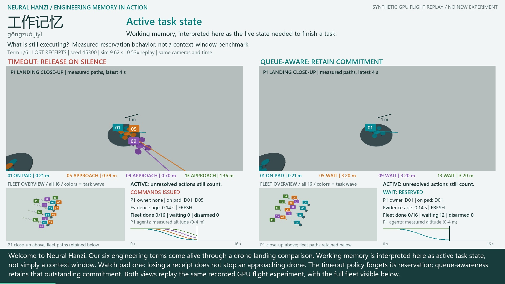

# Neural Hanzi: Six Memory Terms, Seen in Drone Landings

A terminology-first lesson, with large, synchronized **pad P1 landing close-ups**
above smaller **full-fleet overviews**. The timeout and queue-aware arms share
camera settings, simulation timestamps, and measured data. Aircraft positions
are not interpolated or replaced by reference trajectories. Colors now identify
task waves consistently in both views; IDs persist.

[](https://github.com/rbajaj5/delay-aware-runtime-assurance-lab/releases/download/neural-hanzi-landings-2026-10-27/neural_hanzi_drone_landings.mp4)

**[Narrated MP4](https://github.com/rbajaj5/delay-aware-runtime-assurance-lab/releases/download/neural-hanzi-landings-2026-10-27/neural_hanzi_drone_landings.mp4)**
| [Six-term script](lesson.json) | [Captions](delivery/captions.srt)
| [Frame audit](delivery/validation.json) | [Original experiment/results](../README.md)

**Measured production time:** 511.62 s render/encode + 2.67 s audio/subtitle
mux for the 189.68 s, 1920 x 1080, 25 fps movie. One observed run on a Core
Ultra 9 275HX / 32 GiB laptop, Intel Graphics OpenGL replay and CPU libx264.
The recorded physics used the RTX 5070 Ti Laptop GPU (12 GB). These timings
exclude the original simulation, speech synthesis, renderer setup, audio
assembly and validation. [Timing record](delivery/timing.json).

## The Six Terms

| Chinese and pinyin | English used in this lesson | What the fleet illustrates |
|---|---|---|
| 工作记忆 / gōngzuò jìyì | **Active task state**, our contextual engineering interpretation of working memory | Preserve an outstanding landing commitment even when its acceptance receipt is lost. This is not a literal replacement translation in every context or a context-window benchmark. |
| 会话状态 / huìhuà zhuàngtài | **Session state** | Episode context, stable command identity, current owner and waiting queue. The film inspects recorded state; it does not test restoration after a restart. |
| 团队记忆 / tuánduì jìyì | **Team memory** | Sharing a map and procedure does not itself allocate exclusive pad use. A shared operational ledger provides a separate coordination mechanism. |
| 记忆片段 / jìyì piànduàn | **Memory fragments** | A delayed pad-clear snapshot has a timestamp and limited relevance to the present. This is an analogy, not a vendor retrieval implementation. |
| 观测时效 / guāncè shíxiào | **Observation freshness** | A 0.6 s age limit gates new clearances. During the outage, retained commitments prevent further allocation but leave drones waiting. This is our engineering label, not a claimed vendor memory category. |
| 长期记忆 / chángqī jìyì | **Long-term memory** | Maps and reusable procedures illustrate persistent knowledge, distinct from a current reservation. No cross-session learning or memory model is implemented. |

All six terms are pronounced in Mandarin, followed by English explanation.
Burned captions and a selectable subtitle track support muted viewing. Voices
are synthetic neural speech, not cloned people. The public script alone is sent
to the online speech service. No private simulation records or credentials are sent.

Chapter starts: **0:00** active task state; **0:33** session state;
**1:02** team memory; **1:30** memory fragments; **2:01** observation freshness;
**2:33** long-term memory. Times are rounded to the nearest second.

## Engineering Sources

Checked October 27, 2026; engineering documentation only, not psychology:

- [Alibaba AgentRun: memory storage](https://help.aliyun.com/zh/agentrun/memory-storage-overview)
  distinguishes persistent memory, conversation history and session state,
  including saving and restoring session context.
- [Tencent Agent Memory](https://cloud.tencent.cn/document/product/1813/132100)
  describes short-term task context, longer-term knowledge, and shared team
  assets. Its short-term-memory category is not claimed to be an exact synonym
  for our use of 工作记忆.
- [Alibaba Bailian: long-term memory](https://help.aliyun.com/zh/model-studio/long-term-memory)
  describes retained memory fragments and structured variables for later use.

These sources motivate the vocabulary. They do not supply, test, or certify
our fleet coordinator. A shared-memory product is not a runtime safety guarantee.

## What Changed, and What Did Not

This is a **teaching and camera revision**, not a fresh GPU experiment. It uses
the existing 16-drone, four-pad MuJoCo Warp CUDA recordings, seed 45300. The
[48-world evidence and failed-run history](../README.md) remain unchanged.
The earlier wide-view video and release are preserved.

The first three terms follow lost-ACK flight from 0 to 52 s. Memory fragments
restart the timely-message episode at 0 s and show 0-14 s. Observation freshness
starts the outage episode and shows 0-32 s. Long-term memory revisits timely
messages at 70-100 s. Each view labels its profile, time and playback multiplier.
The lesson selects windows; it does not show every retained state or all seeds.
In the conclusion, from simulated time 80 s, the large panels return to the
full fleet rather than lingering on an empty landing pad. Both arms switch
camera together; the small overviews remain visible throughout.

Close-ups focus on P1 and label drones 01, 05, 09 and 13. Other drones remain
present in the physical scene and overview. Close-up trails show the previous
four seconds; the overview retains history. Small altitude charts use each
chapter's time window and the same recorded timestamps as both cameras.

Both arms reject old observations. In the memory-fragment chapter, the time-zero
pad-clear observation is deliberately delivered again at 4.5 s; it cannot
replace the newer observation. Other jittered messages can also arrive out of
order, so the total rejection count is not the count of this single fragment.

The local flight controller is not an LLM. Both arms have the same 70-degree
tilt-disarm rule. Contact trajectories are illustrative, not calibrated crash
predictions. No battery-safe indefinite-hover, hardware, or commercial-memory
benchmark claim is made. The registered course study remains separate.

## Reproduce

From this directory, use the parent experiment's pinned physics/render
environment and its separate voice environment. FFmpeg/ffprobe and the Windows
fonts used in the parent renderer are required. The only large input is the
previous release's trajectory archive:

```powershell
gh release download gpu-fleet-trajectories-2026-10-27 --repo rbajaj5/delay-aware-runtime-assurance-lab --pattern trajectories.npz --dir ../evidence_v2
python speech.py
python render.py --preview
python render.py
python verify.py
```

`delivery/timeline.json` links speech to selected simulation windows;
`delivery/frame_manifest.json` links each movie frame to the exact GPU state.
The media audit checks waveform presence, all source-state links, camera bounds,
full decoding and encoded-image comparisons. It is not an automatic Mandarin
pronunciation test. Online speech synthesis and GPU simulation are not claimed
to be bitwise reproducible across service or hardware changes.

## Verification and Replay Coverage

All 4,742 encoded-frame links passed verification against the saved states;
full decoding, 12 audio cues, subtitle presence, and six encoded-image checks
passed. The camera audit checked 480,096 recorded position centers in the
overview and 24,311 near-P1 landing centers in the close-up, including retained
samples not displayed in the movie. These are framing checks, not safety trials
or checks of every silhouette pixel. All nine existing controller/protocol unit
tests also passed; physics source and evidence are unchanged.

| Featured profile, seed 45300 | Unique state indices shown per arm | Retained per arm | Selected simulation windows |
|---|---:|---:|---|
| Timely messages | 1,545 | 5,001 | 0-14 s and 70-100 s |
| Lost acceptance receipts | 2,068 | 5,001 | 0-52 s |
| Telemetry outage | 743 | 5,001 | 0-32 s |

The same indices are used in the two arms, close-ups, overviews and plots.
Slow playback can repeat a state; frame counts are not independent trials.
